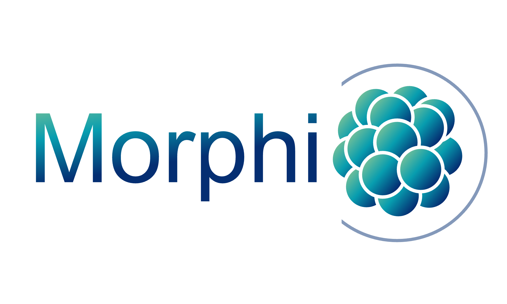
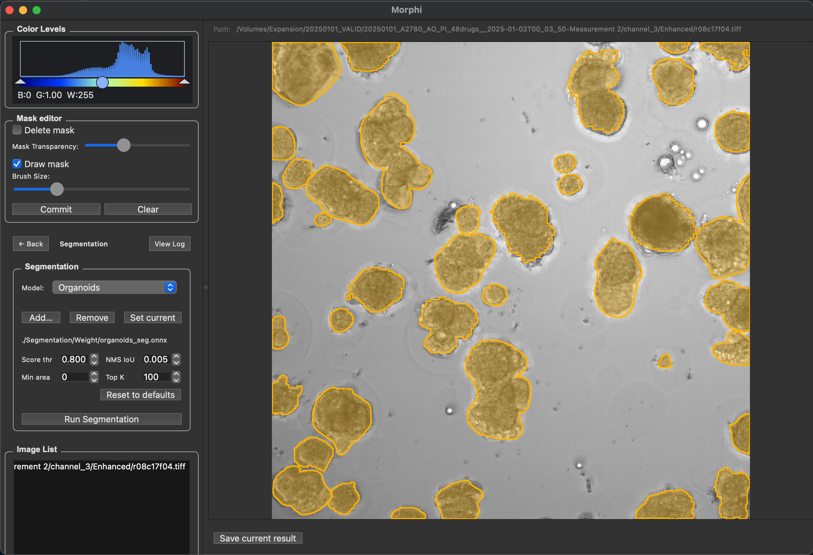

<h1>Morphi</h1>

AI-powered organoid analysis platform integrating:
1. z-stack projection
2. fluorescence quantification
3. instance segmentation
4. organoid viability assessment

[Documentation](https://xxx.github.io/Morphi/) |
[Datasets](链接) |
[Paper](链接)

<h2>Interface</h2>

  

<h2>Installation</h2>

<h3>macOS application</h3>

  Download the latest <code>Morphi.app</code> from the
  <a href="https://github.com/xxx/Morphi/releases">Releases</a> page
  and move it to the <code>Applications</code> folder.

  Morphi can then be launched directly from the Applications folder.

<h4>Optional: Terminal launcher</h4>

  To launch Morphi from Terminal using the <code>morphi</code> command,
  install the command-line launcher:

<pre><code>sudo mkdir -p /usr/local/bin

sudo tee /usr/local/bin/morphi &gt; /dev/null &lt;&lt;'EOF'
#!/bin/sh
open "/Applications/Morphi.app"
EOF

sudo chmod +x /usr/local/bin/morphi</code></pre>

  Morphi can then be launched from any directory:

<pre><code>morphi</code></pre>

<h2>Usage</h2>

  Launch Morphi from the Applications folder or from Terminal:

<pre><code>morphi</code></pre>

  For detailed usage instructions, see the
  <a href="https://xxx.github.io/Morphi/">Documentation</a>.

<h2>Installation</h2>

  Morphi can be installed as a standalone macOS application or run directly from source.

<h3>Option 1: macOS application</h3>

  Download the latest <code>Morphi.app</code> from the
  <a href="https://github.com/JinLab-Westlake/Morphi/releases">Releases</a> page.

  Move <code>Morphi.app</code> to the <code>Applications</code> folder.

  Morphi is packaged as a standalone application, so no separate Python environment
  or dependency installation is required.

  Once installed, Morphi can be launched from any directory using:

<pre><code>morphi</code></pre>

  Morphi uses application-relative resource paths, so it does not depend on the
  current working directory.

<h3>Option 2: Run from source</h3>

Clone the repository:

<pre><code>git clone https://github.com/JinLab-Westlake/Morphi.git
cd Morphi</code></pre>

Create and activate a virtual environment:

<pre><code>python -m venv .venv
source .venv/bin/activate</code></pre>

Install the required dependencies:

<pre><code>pip install -r requirements.txt</code></pre>

Run Morphi:

<pre><code>python morphi/main.py</code></pre>

<h2>Model weight</h2>

The
  <a href="https://github.com/JinLab-Westlake/Morphi-models" target="_blank">
    DoANet
  </a> and
  <a href="https://github.com/JinLab-Westlake/Morphi-models" target="_blank">
    Instance-Segmentation
  </a>model export are based on ONNX format.

  The trained model weights are available for download from
  <a href="YOUR_URL" target="_blank">Morphi-weight</a>.

  Model training code can be found on
  <a href="https://github.com/JinLab-Westlake/Morphi-models" target="_blank">
    Morphi-models
  </a>.

<h2>Citation</h2>

Citation information after publication of the paper.

<h2>License</h2>

Code license
